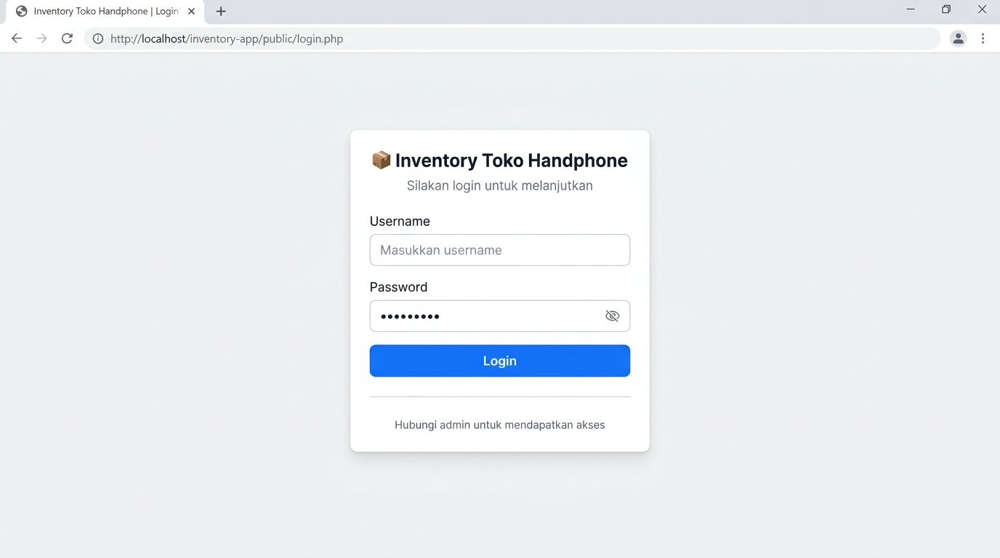
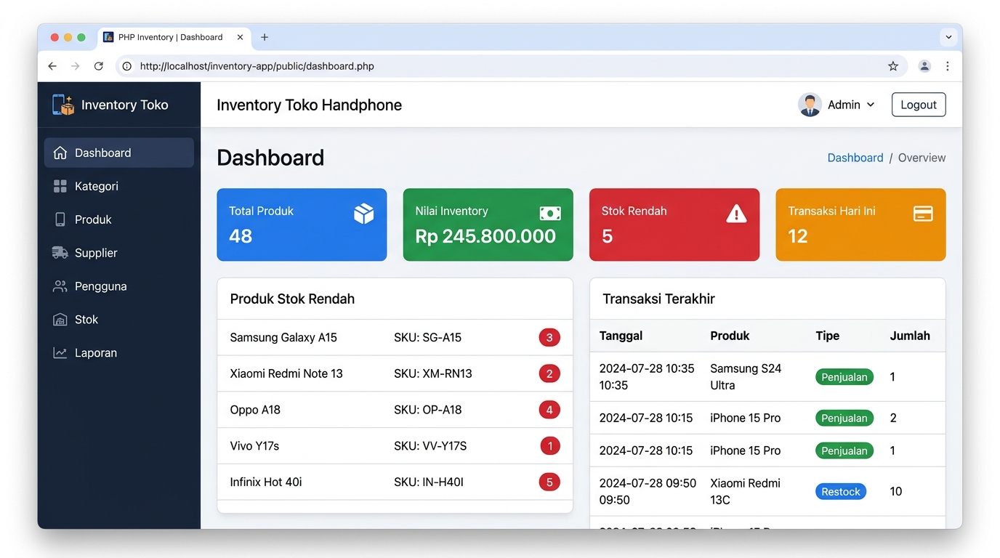
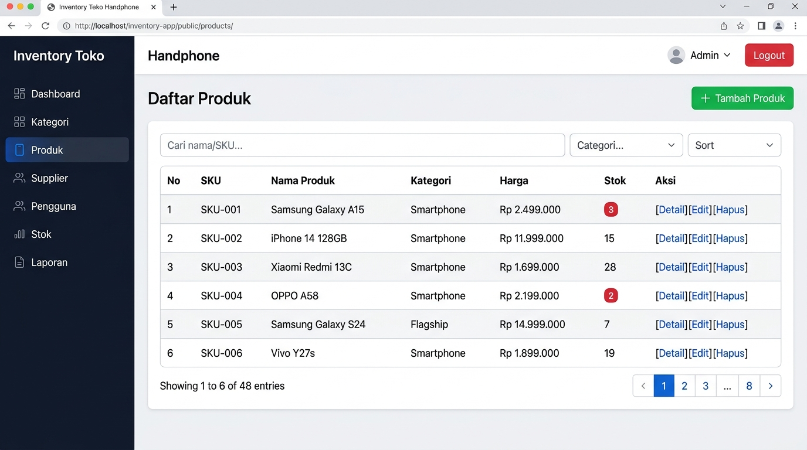

# 📦 Inventory Management System — Toko Handphone

Aplikasi web manajemen inventaris untuk **Toko Handphone** berbasis **PHP Native** (PDO + Prepared Statement) dan **MySQL**.  
Mini Project 3 — Mata Kuliah **Pemrograman Web 4** (Relational Database + Advanced PHP).

---

## 📸 Screenshots

### 🔐 Halaman Login


### 🖥️ Dashboard


### 📱 Daftar Produk


---

## 🚀 Fitur Utama

- 🔐 **Autentikasi** — Login/logout dengan password di-hash (`password_hash` / `password_verify`), session aman dengan `session_regenerate_id(true)`
- 👥 **Role-based Access** — Role **admin** (full access) dan **staff** (view + transaksi). Otorisasi dicek di server
- 📦 **CRUD Lengkap** — Kategori, Produk (SKU unik), Supplier (many-to-many), Pengguna
- 🔄 **Transaksi Stok** — Barang masuk/keluar dengan `DB Transaction` (`commit` / `rollBack`); stok tidak bisa negatif
- 🔍 **Search & Filter** — Cari produk berdasarkan nama/SKU, filter kategori, sort ASC/DESC, pagination
- 📊 **Dashboard & Laporan** — Total produk, nilai inventory, stok rendah, laporan dengan JOIN + GROUP BY
- 🛡️ **Keamanan** — Validasi server-side, `htmlspecialchars()`, token CSRF, folder non-publik diblokir `.htaccess`
- 📱 **Responsif** — Sidebar, kartu statistik, indikator stok rendah

---

## 🛠️ Teknologi

| Teknologi | Keterangan |
|-----------|------------|
| PHP 8.0+ | Backend, PDO, Prepared Statement |
| MySQL 8 / MariaDB 10.4+ | Database relasional |
| HTML/CSS/JavaScript | Frontend |
| XAMPP | Local development server |

---

## ⚙️ Kebutuhan Sistem

- **XAMPP** dengan PHP 8.0+ dan MySQL 8 / MariaDB 10.4+
- Ekstensi `pdo_mysql` aktif
- Browser modern (Chrome, Firefox, Edge)

---

## 🔧 Cara Instalasi

### 1. Jalankan XAMPP
Aktifkan **Apache** dan **MySQL** di XAMPP Control Panel.

### 2. Salin Project
```
C:\xampp\htdocs\inventory-app\
```
> Nama folder harus sama dengan `BASE_URL` di `config/app.php`

### 3. Import Database
Buka `http://localhost/phpmyadmin` → **Import**:
1. Import `database/schema.sql` (struktur tabel)
2. Import `database/seed.sql` (data contoh)

### 4. Konfigurasi Database
Default XAMPP (`root`, tanpa password) langsung bekerja.  
Jika MySQL berpassword, salin dan isi:
```
config/database.local.example.php → config/database.local.php
```
> File `database.local.php` diabaikan Git (ada di `.gitignore`)

### 5. Buat Akun Pengguna
Jalankan via Command Prompt:
```bash
cd C:\xampp\htdocs\inventory-app

# Buat akun admin
C:\xampp\php\php.exe database\create_user.php admin <PASSWORD_ADMIN> admin "Administrator"

# Buat akun staff
C:\xampp\php\php.exe database\create_user.php staff1 <PASSWORD_STAFF> staff "Staff Gudang"
```
> Ganti `<PASSWORD_...>` dengan password Anda (minimal 8 karakter)

### 6. Buka Aplikasi
```
http://localhost/inventory-app/public/login.php
```

---

## 📁 Struktur Project

```
inventory-app/
├── bootstrap.php          # Autoload & konfigurasi awal
├── config/
│   ├── app.php            # Konfigurasi aplikasi (BASE_URL, dll)
│   ├── database.php       # Konfigurasi database
│   └── database.local.example.php
├── helpers/               # auth, escape, flash, validation,
│                          # pagination, product, stock
├── views/                 # header, footer, 403, stock_transaction
├── database/
│   ├── schema.sql         # Struktur tabel
│   ├── seed.sql           # Data contoh toko handphone
│   └── create_user.php    # Script buat akun
├── docs/
│   ├── PANDUAN.md         # Panduan lengkap & error handling
│   ├── PENGUJIAN.md       # Skenario pengujian
│   ├── LAPORAN.md         # Bahan laporan
│   └── ERD.mermaid        # Entity Relationship Diagram
├── screenshots/           # Screenshot aplikasi
└── public/                # Entry point (hanya folder ini yang diakses)
    ├── login.php
    ├── logout.php
    ├── dashboard.php
    ├── categories/
    ├── products/
    ├── suppliers/
    ├── users/
    ├── stock/
    └── assets/
```

---

## 👥 Hak Akses Per Role

| Fitur | Admin | Staff |
|-------|:-----:|:-----:|
| Dashboard | ✅ | ✅ |
| Lihat Produk | ✅ | ✅ |
| CRUD Produk | ✅ | ❌ |
| CRUD Kategori | ✅ | ❌ |
| CRUD Supplier | ✅ | ❌ |
| Kelola Pengguna | ✅ | ❌ |
| Catat Transaksi Stok | ✅ | ✅ |
| Laporan | ✅ | ✅ |

---

## 🗺️ Halaman Utama

| URL | Halaman |
|-----|---------|
| `/public/login.php` | Login |
| `/public/dashboard.php` | Dashboard |
| `/public/products/` | Daftar Produk |
| `/public/categories/` | Kategori |
| `/public/suppliers/` | Supplier |
| `/public/users/` | Kelola Pengguna (admin) |
| `/public/stock/` | Transaksi Stok |

---

## ❗ Error Umum & Solusi

| Error | Solusi |
|-------|--------|
| Halaman tidak ditemukan | Pastikan nama folder = `inventory-app` di `htdocs` |
| SQLSTATE connection refused | Pastikan MySQL XAMPP menyala |
| Unknown database | Import `schema.sql` via phpMyAdmin |
| No such file `.env` | Gunakan `config/database.local.php` (lihat langkah 4) |
| 419 / Token CSRF invalid | Jangan buka dua tab login bersamaan |
| Password tidak cocok | Gunakan script `create_user.php`, bukan input manual SQL |

> 📖 Panduan lengkap: [`docs/PANDUAN.md`](docs/PANDUAN.md)  
> 🧪 Skenario pengujian: [`docs/PENGUJIAN.md`](docs/PENGUJIAN.md)

---

## 📝 Catatan

- Data contoh (merek, model, harga) bersifat fiktif
- Folder selain `public/` diblokir lewat `.htaccess`
- Akses aplikasi **hanya** melalui `/public/`

---

## 👤 Author

**dewirikandi5**  
Mini Project 3 — Pemrograman Web 4
